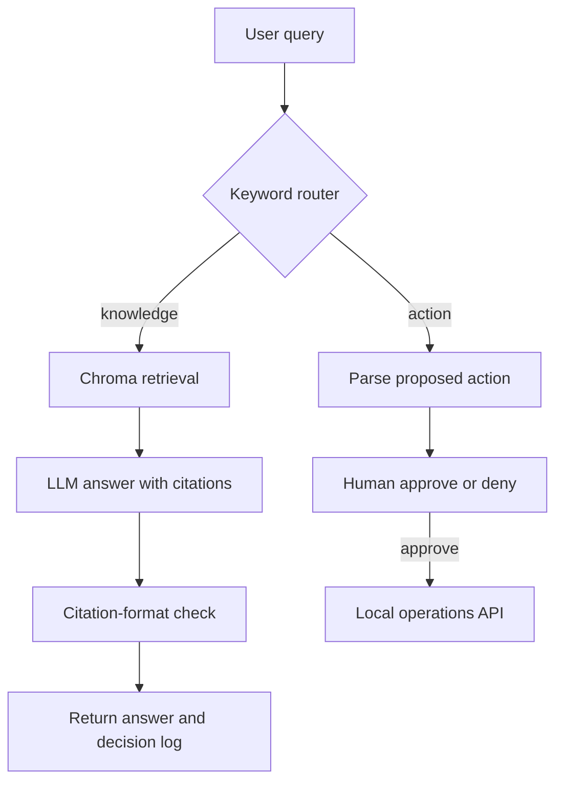

# Multi-agent RAG router

A LangGraph proof of concept that routes a request into one of two paths: retrieve and answer from local documents, or propose a small operational action for human approval.

The project demonstrates graph orchestration and interface boundaries. Routing is keyword-based, the grounding critic checks citation format rather than factual support, and actions target a local stub API. Those limits are intentional and visible.

## Graph



The knowledge path embeds the query, retrieves document chunks and asks the configured Groq model to answer with filename/page citations. The action path recognizes pause, unpause and operating-hours phrases, then displays structured parameters before any request is sent.

## Components

| Path | Responsibility |
|---|---|
| `agents/graph.py` | LangGraph state, nodes and routing |
| `agents/llm.py` | Groq composition and streaming boundary |
| `ingestion/` | PDF chunking, metadata and Chroma indexing |
| `apps/ui/streamlit_app.py` | Chat, decision log, sources and approval UI |
| `connectors/ops_stub_api/` | File-backed demonstration actions and audit log |
| `scripts/query_index.py` | Command-line knowledge query |

## Run locally

Prerequisites: Python, a Groq API key and network access for model/embedding downloads and provider calls.

```bash
git clone https://github.com/alirazawatoo/multi-agent-rag-router.git
cd multi-agent-rag-router
python -m venv .venv
source .venv/bin/activate
pip install -r requirements.txt
cp .env.example .env
```

Set `GROQ_API_KEY` in `.env`. Add PDFs to `data/raw`, then build the local index:

```bash
python ingestion/build_index.py
```

Start the optional action stub and Streamlit interface in separate terminals:

```bash
uvicorn connectors.ops_stub_api.main:app --port 8001
streamlit run apps/ui/streamlit_app.py
```

For a knowledge query without the UI:

```bash
python scripts/query_index.py "What does the onboarding guide require?"
```

Provider calls may incur charges.

## Example decisions

| Query | Route | Result |
|---|---|---|
| “What are the onboarding requirements?” | Knowledge | Retrieve chunks, compose answer, check citation pattern |
| “Pause daily backup process” | Action | Propose `pause_item` for approval |
| “Update hours to 9–6” | Action | Propose `update_hours` for approval |

The Streamlit decision log shows which route and nodes ran. It is operational trace output, not hidden model reasoning.

## Safety boundary

Actions do not execute directly from the router. The UI displays the parsed action and requires approval before calling the stub API. The stub persists state and an audit log to local files; it has no authentication, authorization or production-system integration.

Before connecting a real system, add authenticated operator identity, action-specific validation, idempotency, authorization, durable audit storage, timeout/retry policy and environment allowlists.

## Grounding boundary

The critic currently checks whether the generated answer contains a citation shaped like `[filename p3]`. It does not verify that the cited passage supports the claim, and it does not reject or repair an unsupported response.

A stronger evaluation loop would compare answer claims against retrieved passages, score citation entailment, reject unsupported output and record evaluation results. The current implementation should therefore be described as citation-formatted RAG, not verified factual grounding.

## Current test status

No assertion-based automated test suite is currently included. High-value tests would cover keyword routing, action parsing, citation detection, retrieval with a temporary Chroma collection, approval denial, and stub audit persistence.

## Scope

- Routing is deterministic keyword matching rather than an LLM classifier.
- The supported action vocabulary is intentionally small.
- The operations API is a local demonstration connector.
- Retrieval quality and factual grounding have not been benchmarked.
- Included source documents should remain synthetic or appropriately licensed.

## Technology

Python, LangGraph, ChromaDB, sentence-transformers, Groq, Streamlit and FastAPI.
