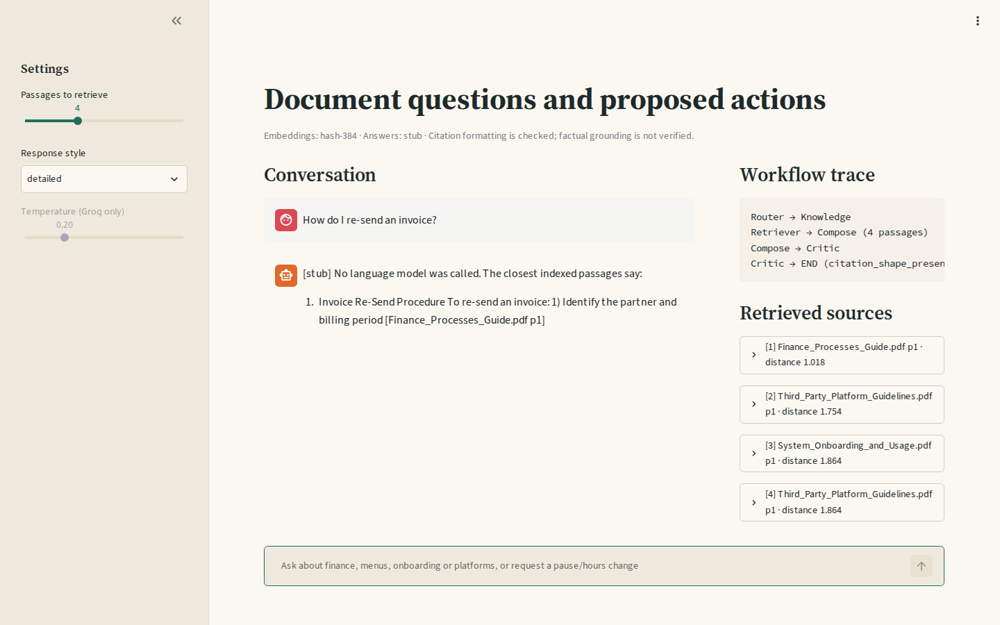
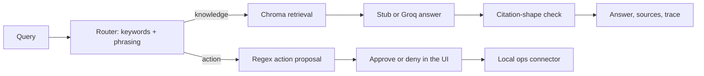
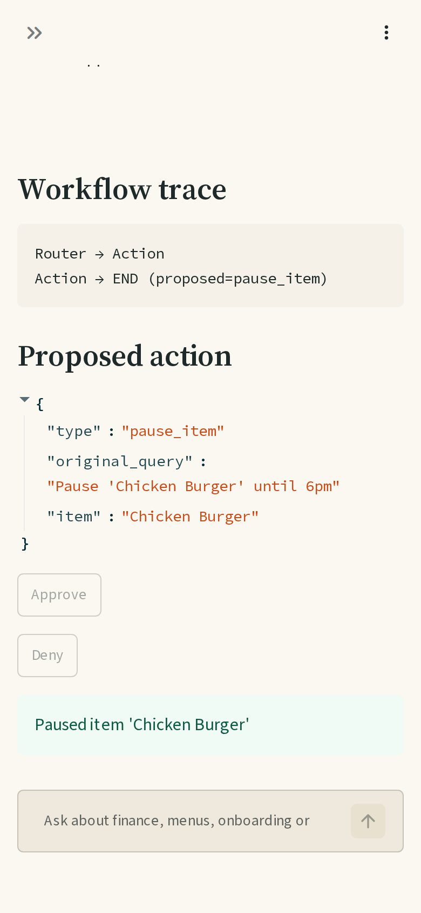

# Document questions, with an action branch

A LangGraph proof of concept for two kinds of operational request: answering questions from indexed PDFs, and proposing a small set of actions (pause or unpause a menu item, change opening hours) for a human to approve. It combines Chroma retrieval, a choice of embedding backend, an offline answer stub or Groq, a FastAPI endpoint and a Streamlit interface.

The workflow is a small graph of nodes, not a team of autonomous agents. The router uses keyword and phrasing rules, and the "critic" only checks that the answer contains a citation-shaped string. Those are deliberate demonstration boundaries, not validated reasoning or factual grounding.



## Follow a request



A question such as "How do I pause a menu item?" goes to retrieval; an instruction such as "Pause 'Chicken Burger' until 6pm" or "Can you update opening hours to 10-22 on Friday?" becomes a proposal. Quoted item names are kept whole, and trailing qualifiers ("until 6pm") are not treated as part of the name.

## Run it with Docker

The Compose stack needs no API keys and makes no model downloads. It generates six synthetic PDFs, indexes them, and starts three services:

```sh
docker compose up --build
```

| Service | URL | What it is |
| --- | --- | --- |
| `api` | http://127.0.0.1:8000/docs | `POST /ask`, `GET /health` |
| `ops` | http://127.0.0.1:8001/docs | the demo connector that approvals are sent to |
| `ui` | http://127.0.0.1:8501 | the Streamlit app |

A one-shot `index` service builds the index into the shared `docdata` volume before `api` and `ui` start. `docker compose down -v` removes it again.

## Run it locally

Python 3.12 (see `.python-version`). From the repository root:

```sh
python -m venv .venv
source .venv/bin/activate
pip install -r requirements.txt
cp .env.example .env
python -m scripts.generate_pdfs
python -m ingestion.build_index --rebuild
python -m uvicorn apps.api.main:app --port 8000                          # HTTP API
python -m uvicorn connectors.ops_stub_api.main:app --port 8001           # demo connector
python -m streamlit run apps/ui/streamlit_app.py --server.address 127.0.0.1
```

The last three commands each keep running, so give them their own terminals. Use `python -m streamlit`, not `streamlit`, so the repository root is on the import path. To inspect retrieval on its own:

```sh
python -m scripts.query_index --q "What are the onboarding steps?" --k 4
```

## Configuration

Everything is read from the environment or `.env` (see [`.env.example`](.env.example)).

| Variable | Default | Effect |
| --- | --- | --- |
| `EMBEDDING_BACKEND` | `hash` | `hash` or `sentence-transformers` |
| `EMBEDDING_MODEL` | `BAAI/bge-small-en-v1.5` | model for the `sentence-transformers` backend |
| `LLM_PROVIDER` | `stub` | `stub` or `groq` |
| `GROQ_API_KEY`, `GROQ_MODEL` | empty, `openai/gpt-oss-20b` | only read when `LLM_PROVIDER=groq` |
| `CHROMA_DB_DIR`, `RAW_DOCS_DIR` | `data/chroma`, `data/raw` | index and source PDF folders |
| `OPS_API_URL`, `OPERATOR_NAME`, `OPS_DATA_DIR` | `http://localhost:8001`, `demo_user`, `data` | connector location, the label sent with approvals, where the connector writes |

### Embedding backends

- **`hash`** (default) turns each word into a position in a 384-dimension vector with a stable hash. It needs no model download or PyTorch, so it runs offline in a small image, but it matches shared words, not meaning. It is what the tests, the Docker stack and the screenshots use.
- **`sentence-transformers`** uses a real semantic model. Install it with `pip install -r requirements-embeddings.txt` (on Linux, install the CPU build of PyTorch first, as the file explains), set `EMBEDDING_BACKEND=sentence-transformers`, and rebuild the index. The model downloads on first use.

The backend's name is stored on the Chroma collection. Querying an index with a different backend fails with a message to run `python -m ingestion.build_index --rebuild`, instead of a vector-dimension error.

### Answer providers

- **`stub`** (default) never calls a network service. For each retrieved passage it quotes the sentence that shares the most words with the question and cites it as `[filename pN]`. Answers start with `[stub]` so they cannot be mistaken for model output.
- **`groq`** sends the question and retrieved text to Groq with a system prompt asking for a cited, step-by-step answer. Do not index confidential documents if you enable it.

## HTTP API

These are real responses from the Docker stack (stub answers, hash embeddings), trimmed only where marked.

```sh
curl -s 127.0.0.1:8000/health
```

```json
{
  "ok": true,
  "indexed_chunks": 9
}
```

A knowledge question (source excerpts trimmed to 60 characters):

```sh
curl -s -X POST 127.0.0.1:8000/ask -H 'content-type: application/json' \
  -d '{"query": "How do I re-send an invoice?", "top_k": 2, "style": "concise"}'
```

```json
{
  "intent": "knowledge",
  "answer": "[stub] No language model was called. The closest indexed passages say:\n1. Invoice Re-Send Procedure To re-send an invoice: 1) Identify the partner and billing period [Finance_Processes_Guide.pdf p1]",
  "citation_shape_present": true,
  "sources": [
    {
      "filename": "Finance_Processes_Guide.pdf",
      "page": 1,
      "distance": 1.018,
      "excerpt": "Finance Processes: Payments, Invoicing, Reconciliation Payme…"
    },
    {
      "filename": "Third_Party_Platform_Guidelines.pdf",
      "page": 1,
      "distance": 1.7544,
      "excerpt": "Third-Party Platforms: Listing Consistency & Remediation Pla…"
    }
  ],
  "proposed_action": null,
  "trace": [
    "Router → Knowledge",
    "Retriever → Compose (2 passages)",
    "Compose → Critic",
    "Critic → END (citation_shape_present=True)"
  ]
}
```

The second source is a weak match (note the larger distance). With the `hash` backend, distance reflects shared words rather than meaning, and the stub leaves out passages that share no meaningful word with the question.

An action request:

```sh
curl -s -X POST 127.0.0.1:8000/ask -H 'content-type: application/json' \
  -d '{"query": "Pause '"'"'Chicken Burger'"'"' until 6pm"}'
```

```json
{
  "intent": "action",
  "answer": "I identified an action request: pause_item. Review the proposed parameters below and approve to execute.",
  "citation_shape_present": null,
  "sources": [],
  "proposed_action": {
    "type": "pause_item",
    "original_query": "Pause 'Chicken Burger' until 6pm",
    "item": "Chicken Burger"
  },
  "trace": [
    "Router → Action",
    "Action → END (proposed=pause_item)"
  ]
}
```

Approving it means posting the proposal, plus an operator label, to the connector:

```sh
curl -s -X POST 127.0.0.1:8001/pause_item -H 'content-type: application/json' \
  -d '{"type": "pause_item", "item": "Chicken Burger", "operator": "demo_user"}'
```

```json
{
  "ok": true,
  "message": "Paused item 'Chicken Burger'",
  "state": {
    "items": {
      "Chicken Burger": "paused"
    },
    "hours_note": ""
  }
}
```

`/ask` never executes anything: the proposal is returned for a person to approve, and approval is a separate call to the connector.

## What approval actually does

The connector in [`connectors/ops_stub_api/main.py`](connectors/ops_stub_api/main.py) changes a local JSON file and appends an audit line. It rejects a payload whose `type` does not match the endpoint. It does not pause a real service or update a merchant platform. It has no authentication, and its files are not safe for concurrent writers, so keep it local. `OPERATOR_NAME` is a label, not a verified identity.

In the UI, Approve and Deny lock once either is pressed, so one proposal cannot be sent twice.



## Ingestion

The loader reads the top-level PDFs in `RAW_DOCS_DIR`, extracts text per page with pypdf and splits it by character count with overlap (900/150 by default). This is character chunking, not semantic segmentation or OCR. Chunk IDs are `<file stem>-p<page>-c<chunk>`, so re-indexing the same files upserts in place, but renamed files and shortened documents leave stale chunks; use `--rebuild` for a clean index.

The sample PDFs come from `scripts/generate_pdfs.py`. Their content is invented for this demo. Platform names such as Deliverect or Uber Eats appear only as examples of where such procedures might apply.

## Tests and lint

```sh
pip install -r requirements-dev.txt
python -m unittest discover -s tests -v
ruff check .
```

The suite has 27 tests and runs offline. It covers chunking, routing and action parsing, the stub answers, the connector (with a temporary data folder), an end-to-end run that generates the PDFs, indexes them with the hash backend and asks the graph and the API, and the Streamlit app rendered headlessly with Streamlit's `AppTest`.

Not covered: the `sentence-transformers` backend, live Groq requests, and answer quality on real documents.

## Notes

The collection is still called `pwb_docs`, a leftover from the project's original name (`PWB_AI_Agent`); renaming it would orphan existing indexes.

## License

MIT, see [LICENSE](LICENSE).
